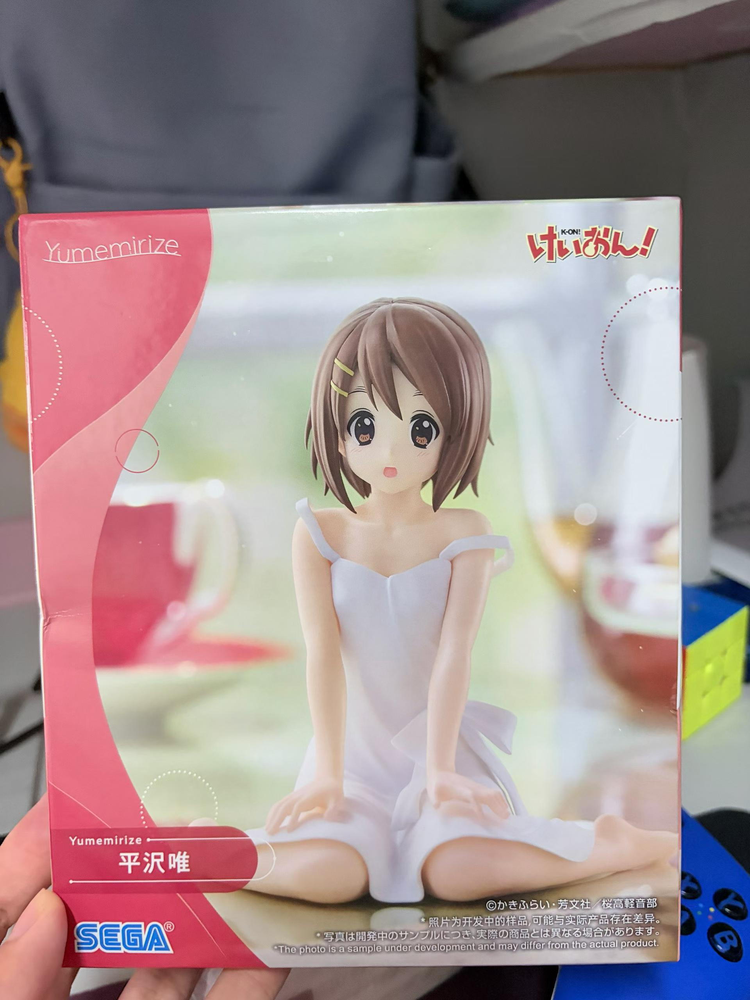
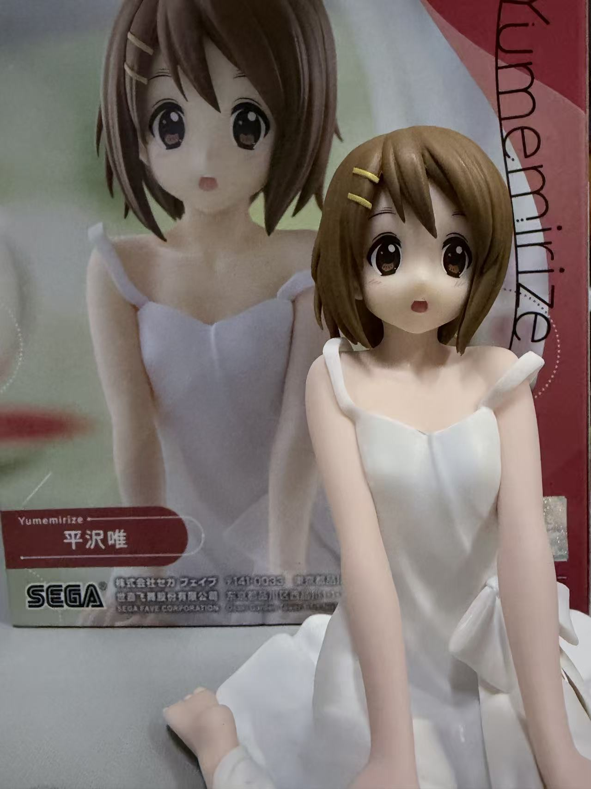

# Foreword
上次更新生活分享都快一年了，今天又来更新生活分享啦~。拖了这么久的更，真是不好意思呢哈哈。也许这就是今年的最后一篇blog吧，因为我懒嘿嘿，但是明年我还会继续更新的！那么现在让我来分享下最近我的生活吧。

# In the past few days

## 学习上
在疯狂的学习Java全栈的知识，目前已经快要学完了。想着应该是大二暑假就去试着找实习吧，虽然计算机行业目前被AI冲的真的很猛，但是我还是会继续努力下去的，毕竟是真的喜欢这个行业啊，说放弃是不可能的。但有一说一，codex和deepseek蹬起来还是挺爽的，现在做项目已经离不开它们了。还有一点，经过我的不断努力，去年下半年的英语四级我成功顺利通过了哈哈~，第一次差了十几分，这次终于/(ㄒoㄒ)/~~ ，我要洋人死(╯▔皿▔)╯。 最近在备考六级，但是不太抱有希望，真的好难啊。。。

## 生活上
今天是我的19岁生日哦！尽管今年的生日是自己一个人过的，但是我还是非常开心的，因为我的室友送给了我一个平泽唯手办当作生日礼物，我真的好开心啊！

最爱呆唯了，真的是太可爱啦~

今年的六月份，Blog的头像换成了平泽唯，因为我看完k-on之后真的陷入了其中，我真的超爱呆唯的！  
`“世界奇奇怪怪，呆唯可可爱爱！”`  
我已经刷了很多次轻音少女了，还特地的写了一遍文章[番剧观后感-轻音少女](番剧观后感-轻音少女.md)，不知道为啥会这么喜欢这部番，里面的每个人物我都喜欢，充满了青春治愈，我看的时候真的是忘乎所以了。

除此之外，我的Blog也大变样了，短短一年，我的Blog和去年相比已经是天壤之别了，我感觉我的审美还真是挺高的呢~现在这个Blog真的是太好看了，自卖自夸嘿嘿。

最近还想着抢孙燕姿长沙演唱会的门票，这个也太难抢了吧/(ㄒoㄒ)/~~ ，一秒就售完了啊，我真的是谢了，不是说是冷门歌手的嘛，我要去听一万遍我很难过...
<iframe frameborder="no" border="0" marginwidth="0" marginheight="0" width=400 height=80 src="https://i.y.qq.com/n2/m/outchain/player/index.html?songid=8136&songtype=0
"></iframe>
孙燕姿的歌真的是太好听了啊啊啊，好想去现场看一次呢~

最近也迷上了玩PUBG

这个游戏16年出的时候我还在读小学3年级，现在我大二了，这个游戏仍然不褪热度，真的是经典，太好玩了。苦练技术中！

# Last but not least
今天的生活分享就到这里吧，如果没有意外的话，下一篇Blog可能是27年才会发了。这个网站我还是会好好运行下去的，毕竟这是我的小家嘛~也希望你也能一直陪着我的小网站走下去！

***今天就这样吧，希望下次你还在这里！***